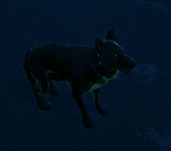
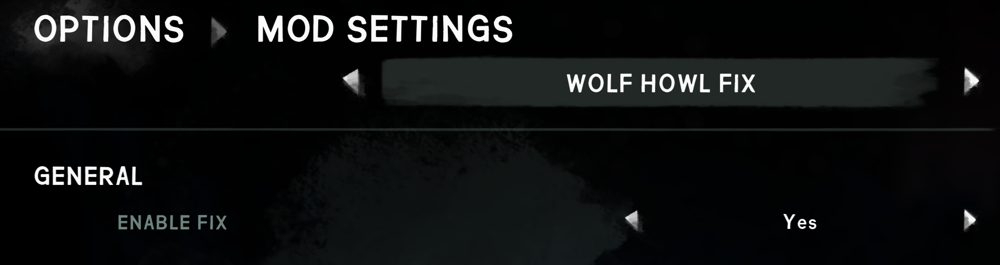

# Wolf Howl Fix

Fixes wolf howl loop bug. Under certain conditions, most noticeable on aurora nights, a wolf can loop and stutter its howl endlessly.

## Requirements

- The Long Dark **2.55**
- **MelonLoader 0.7.2**
- **ModSettings**

## Install

Put `WolfHowlFix.dll` in your `Mods/` folder. To uninstall, delete it.

Nothing is written to your save.

## Settings

**Options → Mod Settings → Wolf Howl Fix**

| Setting | Default | |
|---|---|---|
| **Enable fix** | on | Turn off to restore the unpatched behaviour. |

## ⚠️ Wolves will be more dangerous

Aurora wolves already detect you from further away than normal wolves — but with the bug that made no difference, since they abandoned the stalk the instant they noticed you. With it fixed, that detection finally has consequence: they will close on you from distances they previously ignored, which is how the game always intended them to behave.

Turn the fix off in Mod Settings if you would rather keep that.

---

Curious how it works? See [BACKGROUND.md](BACKGROUND.md).

MIT — see [LICENSE](LICENSE).
